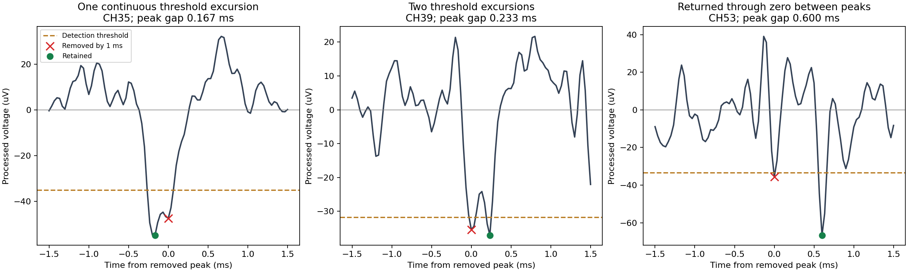
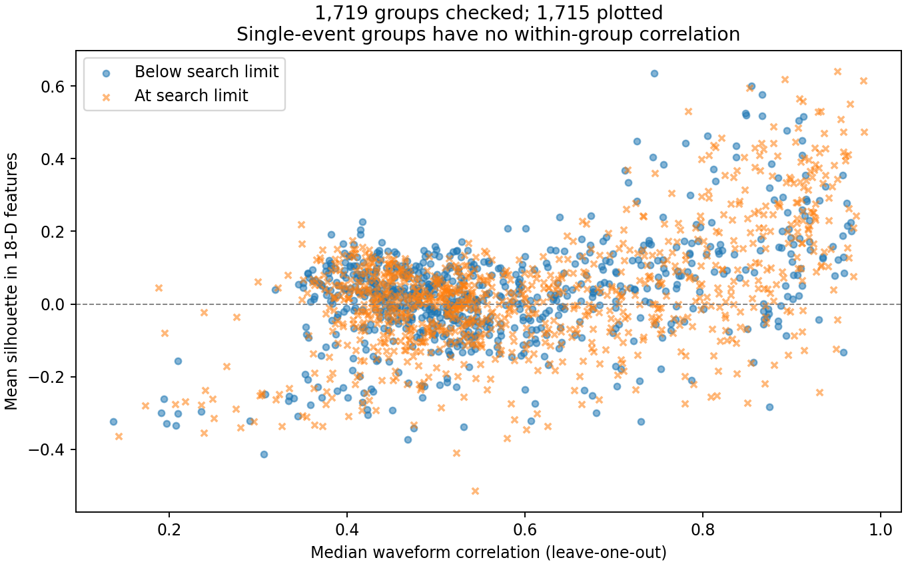
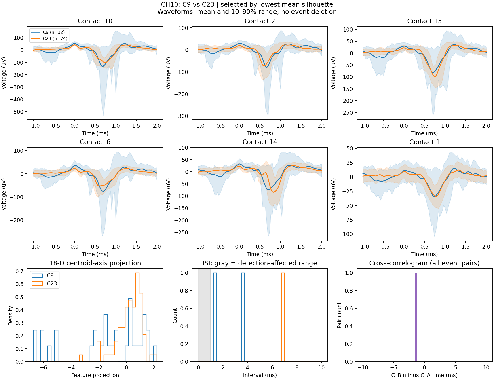

# Set11 中文报告

[分析 Notebook](set11_analysis.ipynb) · [结果清单](results/RESULTS_INDEX.md)

重跑时，在仓库根目录打开Notebook，安装`requirements.txt`，并放入原课程数据`02_raw_data/Set 11/`和课程读取工具`01_original_submissions/analysis-tools/NeuroData/Python3/OpenEphys.py`。也支持当前目录旁的原课程`project/`作为数据来源。结果保存到本仓库的`results/`。

完整多接点波形`results/05_waveforms/waveforms.npy`约748 MB，保留在本地，未上传；运行第5步可重新生成。其事件表、分组结果及本次1 ms对照的压缩波形均已提供。

**第1–6步已有结果。第7步已检查全部1,719组，并完成827对试合并比较。4个单事件组归为事件不足；其余组的论文时间条件已计算，波形分类待逐组复核。3对进入合并复核，未执行合并或删除。**

## 流程进度

| 步骤 | 要做什么 | 进度 |
|---|---|---|
| 1 | 读数据，确定有效时间和可用通道 | 完成。336.5888 秒，保留 63 个通道。 |
| 2 | 滤波，减少多个通道共有的波动 | 抽样检查完成。 |
| 3 | 估计背景波动，检测正峰和负峰 | 完成。用 ±4.5 倍阈值和 1 ms 最短峰间隔检出 586,138 个候选峰。 |
| 4 | 合并相邻接点上的重复检测 | 完成。586,138 个峰合并为 342,534 个候选事件。 |
| 5 | 截取候选事件的多接点波形 | 完成。342,533 个事件各保存 6 条波形。 |
| 6 | 用 PCA 提取波形特征并分组 | 已完成初步分组。1,719 个候选组，33 个主接点触及组数搜索上限。 |
| 7 | 检查组的质量和双相重复 | 4组归为事件不足；1,715组已计算论文时间条件。827对试合并中3对进入复核，尚未正式合并。 |
| 8 | 按声音开始时间汇总放电 | 待做 |
| 9 | 比较不同声音频率的响应 | 待做 |
| 10 | 比较单元之间的放电时间关系 | 待做 |
| 11 | 汇总并与 Set12 比较 | 待做 |

进度和数值来自新版 notebook 已保存的结果文件。[结果清单](results/RESULTS_INDEX.md)

## 第 1 步：读数据和检查通道

| 单元格 | 做了什么 | 得到了什么 |
|---|---|---|
| 1 · `from pathlib import Path` | 加载工具，找到数据和结果目录。 | 后面各格可以读写对应文件。 |
| 2 · `mapping = loadmat(...)` | 读取通道映射，核对文件数、采样率和时间戳。 | 64 个文件，每通道 30 kHz。最后一块在所有通道同时为零，且前面有时间缺口，因此分析时跳过这 1,024 点。剩余记录无缺口或重复，共 336.5888 秒。 |
| 3 · `quality_rows = []` | 按连接状态和整段电压是否恒定决定保留哪些通道，同时统计电压波动和量程端点。 | 排除映射中标为未连接的 CH38，保留其余 63 个通道。没有整段恒定的通道，也没有采样点达到 ADC 量程端点。CH18 波动偏小，仍保留。 |

**依据**：采样率、连接状态和接点坐标来自实验文件。记录格式依据课程提供的 Open Ephys 读取代码（R1）。通道选择用连接标记和整段是否为平线来判断。

**Notebook 显示**：通道数、采样率、有效时长，以及排除通道和是否有采样点达到量程端点的汇总。末尾跳过原因、时间轴检查结果和逐通道统计存到 CSV。记录起始硬件时间戳也已保存；后续可用“起始时间戳＋相对采样点”对照刺激时间。

[记录汇总](results/01_input_check/recording_summary.csv) · [通道统计](results/01_input_check/channels.csv)

## 第 2 步：滤波和共同中位数参考

| 单元格 | 做了什么 | 方法和参数的依据 |
|---|---|---|
| 4 · `LOW_HZ, HIGH_HZ = 300, 6000` | 先用 300–6000 Hz 带通滤波，再从每个时刻的电压中减去 63 个通道在该时刻的中位数。 | 频段和顺序参考 SpikeInterface（R2）。正反滤波避免时间偏移（R3）。三阶 Butterworth 和两侧各多读 0.1 秒是本项目的设置。 |
| 4 · 抽取时间窗 | 把记录分成六段，每段随机抽 5 秒。 | 分散抽样参考 SpikeInterface（R7）。六段、5 秒和随机种子 11 是本项目的设置。固定种子可以重现同一批窗口。 |
| 5 · `stage_names = [...]` | 用 Welch 频谱看各频率的功率，用 MAD 衡量各通道的典型电压波动。 | Welch 方法见 R4–R5，MAD 方法见 R6–R7。这里用 1 秒 Hann 窗、50% 重叠。每通道对六窗 MAD 取中位数是本项目的汇总方式。 |

**MAD 是什么**：先找电压的中位数，再看每个点离这个中位数多远，取这些距离的中位数。代码把它换算成以 µV 表示的波动尺度。少数大峰对这个数影响较小。

**看到了什么**

- **带通起效了。** 六个窗口里，300 Hz 以下的功率典型下降 **99.47%**，6000 Hz 以上下降 **96.02%**。这说明滤波压低了设定频段外的功率。300–6000 Hz 继续作为目前的工作范围。
- **共同中位数参考让典型波动量再降约 20%。** 先对每个通道比较参考前后的 MAD，再看各通道比值的中位数，得到 **0.801**。多数通道共同出现的电压变化会影响中位数，少数接点上的大峰对它影响较小。
- **不同时间段仍有差别。** 例如 CH18 在第三个窗口的 MAD 约为它六窗中位数的 **2.22 倍**。

**Notebook 显示**：一张双栏图，左边是处理前后的频谱，右边是共同中位数参考前后的 MAD。另显示参考后各通道六窗 MAD 中位数的范围，为 **4.311–11.084 µV**。抽样起止时间和逐窗 MAD 比较存到 CSV。

[抽样时间](results/02_preprocessing/windows.csv) · [处理前后指标](results/02_preprocessing/preprocessing_metrics.csv) · [逐窗比较](results/02_preprocessing/window_scale_comparison.csv) · [频谱与波动图](results/02_preprocessing/preprocessing_overview.png)

## 为什么抽六个窗口

六个 5 秒窗口合计 30 秒，分散在整段约 337 秒的记录中。每个窗口都检查 63 个保留通道，用来比较处理前后的频谱和电压波动，也能看出不同时段有没有明显差异。六个和五秒是本项目选的抽样规模。这六段数据直接用于计算频谱和 MAD。

## 第 3 步：检测阈值的选择

**Set11 沿用 4.5 倍，同时检测正峰和负峰。** 对每个通道，用第 2 步六个窗口的背景尺度取中位数。每个窗口的背景尺度是处理后电压的 MAD 除以 0.6745。正、负阈值分别是这个通道背景尺度的 +4.5 倍和 −4.5 倍。例如，背景尺度为 7 µV 时，阈值是 +31.5 µV 和 −31.5 µV。

**为什么选 4.5 倍**：旧版 Set11 已用过这个倍数，沿用可以保持阈值倍数一致。文献综述给出的常用范围是估计背景噪声标准差的 3–5 倍，也有已发表的多电极研究用 4.5 倍逐通道检测。该研究的数据来自脑类器官，提供的是参数使用先例。Set11 将 4.5 倍作为工作参数，六窗取中位数是本项目的汇总方式。

[Spike sorting 方法综述](https://pmc.ncbi.nlm.nih.gov/articles/PMC4674014/) · [NeuroSuite 的 4.5 倍检测先例](https://doi.org/10.1002/advs.202519893)

第 6 个代码单元格每次读取 10 秒，两端尽可能多读 0.1 秒用于滤波，只收集该段内的峰。10 秒是为控制内存选的。它逐通道找达到正负阈值的局部峰谷，把采样点、相对记录开始的时间、通道、带符号的幅度和正负方向保存到 `results/03_peak_detection/candidate_peaks.csv`。

**最短峰间隔**：同一个通道的正峰和负峰分别找。两个同方向的峰相隔不到 **1 ms（30 个采样点）** 时，优先保留绝对幅度更大的峰。它也可能压掉不同神经元恰好相距很近的同方向峰；这是检测阶段的取舍，不是单神经元质量判据。这个设置沿用旧版 Set11，用来减少一段波形被重复找峰。多电极体感皮层研究也用过 1 ms 并保留最大峰。 [PLOS ONE，2014，方法部分](https://doi.org/10.1371/journal.pone.0107617)

**实际结果**：63 个通道共检出 **586,138 个候选峰**，其中正峰 **173,391** 个、负峰 **412,747** 个。单个通道的检测率中位数为 **26.7 个峰/秒**，各通道约 **9.2–66.3 个峰/秒**。

表中每一行记录某个通道在某个时刻检出的峰，可用采样点和接点位置找出相邻通道对同一次放电的重复检测。论文也指出，多电极阵列上一次放电可以在多个相邻通道越过阈值。总数是否偏高，需要在相近的记录条件和检测规则下比较。现有计数包含正负峰和跨接点重复，统计口径是逐通道候选峰。 [候选峰表](results/03_peak_detection/candidate_peaks.csv) · [Swindale 与 Spacek，2015](https://pubmed.ncbi.nlm.nih.gov/25409922/)

## 1 ms检测间隔对照：实际舍弃了什么

**这次只改变找峰时是否设置1 ms间隔。滤波、共同中位数参考、逐通道4.5倍阈值全部相同。** 使用原有六个5秒窗口的全部63个通道，共30秒。不是选择个别通道来代替整体结果。

| 找峰设置 | 六窗候选峰数 |
|---|---:|
| 不设置最小间隔 | 58,376 |
| 设置1 ms（30个采样点），正负方向分别检测 | 52,537 |
| 被1 ms规则舍弃 | 5,839（10.00%） |

每个舍弃峰都找到一个1 ms内仍被保留、同通道同方向且幅度不小于它的峰。对照两峰之间的电压，得到以下结果：

| 舍弃峰与保留峰之间发生了什么 | 舍弃峰数 | 占全部舍弃峰 | 两峰时间差中位数 |
|---|---:|---:|---:|
| 一直超过同方向阈值，中间没有退回阈值以内 | 2,483 | 42.52% | 0.167 ms |
| 中间退回阈值以内，但没有穿过零线 | 1,628 | 27.88% | 0.233 ms |
| 中间已经穿过零线，之后再次越阈 | 1,728 | 29.59% | 0.600 ms |

**得到的结论：1 ms既会清掉同一次越阈里的多个局部峰，也会舍弃再次越阈的峰。** 后两类合计3,356个，占舍弃峰的57.48%。所以不能把1 ms舍弃的所有峰都叫作重复检测。这里统计的是电压形状，不是新增神经元数量。

### 唯一新增的波形图

- **绿色圆点**：1 ms规则保留的峰。
- **红色叉号**：因为附近有更大的同方向峰而被舍弃的峰。
- **虚线**：该通道的负向检测阈值。这里的三个例子都是负峰；统计包含全部正负峰。
- **左图CH35**：两个小谷位于同一次连续越阈中，1 ms保留其中更深的谷。
- **中图CH39**：两谷之间已回到阈值以内，第二次越阈仍受到1 ms规则影响。
- **右图CH53**：两谷之间已经穿过零线，0.6 ms后又出现更大的负峰，前一个负峰被舍弃。

三个例子分别从对应类别中选择：按峰间距和中间电压深度的百分位，选最接近该类别中间水平的一对；不是手工挑出差异最大的波形。类别的总数来自全部六窗，例图只解释三种现象。峰对和选图编号已保存。

### 六个窗口各自的结果

| 窗口 | 无间隔限制 | 有1 ms限制 | 舍弃峰 |
|---|---:|---:|---:|
| 1 | 8,888 | 8,176 | 712 |
| 2 | 10,074 | 9,160 | 914 |
| 3 | 14,624 | 12,258 | 2,366 |
| 4 | 7,438 | 6,992 | 446 |
| 5 | 7,586 | 6,986 | 600 |
| 6 | 9,766 | 8,965 | 801 |

**对质量分类的具体影响**：检测已压掉部分1 ms以内的同方向峰，短间隔比例会受到影响。第7步不能仅凭短间隔比例低就给出单神经元标签。本次没有改变正式1 ms参数，没有重写正式候选峰、合并事件、波形或分组结果。

**方法依据与项目选择**：SciPy `find_peaks(distance=30)`优先去掉较小峰以满足30点最小间距，见[官方文档](https://docs.scipy.org/doc/scipy-1.13.1/reference/generated/scipy.signal.find_peaks.html)。同一输入只改变一个参数是本次对照方式；按是否退回阈值以内、是否穿过零线分成三类，是本项目对删峰行为的描述，不是论文中的神经元分类门槛。

**复现**：第8格定义了 `check_peak_interval()`，调用后生成统计、逐峰记录和六接点波形；`plot_interval_comparison()`只读取这些结果生成上面这一张图。这两个函数默认不重复运行。

### 本次对照后的决定

**保留1 ms同通道、同极性检测间隔。** 这个设置既减少密集局部峰，也会舍弃部分再次越阈的峰。报告将这种影响明确记录为**检测删失（censoring）**，质量评估参考[Hill等（2011）](https://pmc.ncbi.nlm.nih.gov/articles/PMC3123734/)。后续不会仅因短间隔比例低就将某组判为单神经元。

第7步目前完成的是双相配对检查。全部候选组的质量检查与分类尚未实施，自动删除保持关闭；尚无新版“最终单神经元数量”。

## 第 4 步：合并距离检查

这次重新使用正式的 **586,138 个候选峰**（含 1 ms 同极性抑制），覆盖全程、所有距离不超过60的接点对。对时间差不超过0.5 ms的跨接点峰对，以两峰时间中点为中心截取前后各1 ms，比较同一时间轴上的电压，计算 Pearson 相关性。正负方向不翻转，同极性和异极性分开统计。

| 坐标距离 | 同极性峰对数 | 同极性相关性中位数 | 异极性峰对数 | 异极性相关性中位数 |
|---|---:|---:|---:|---:|
| >0–20 | 154,353 | 0.748 | 62,109 | 0.748 |
| >20–30 | 316,672 | 0.824 | 106,696 | 0.835 |
| >30–40 | 328,788 | 0.664 | 151,371 | 0.595 |
| >40–60 | 330,669 | 0.499 | 180,421 | 0.349 |

**结果**：两类峰对都在距离超过30后呈现相关性下降。继续使用30作为本项目工作半径。它来自数据比较，不是论文规定的统一距离。这里的“异极性”指检出的两个峰符号不同；相关性比较的是整段原始方向的波形，因此相关性仍可能为正。

`chanMap.mat`提供了坐标，但未标注物理单位；目前如实写“坐标单位”，不将30直接写成30 μm。此前未加1 ms抑制的距离统计已由本次结果替代。

复现代码在第8个单元格的 `check_merge_inputs()`。默认只定义函数，不重复运行检查。它保存分位数和相关性直方图的数值，不新增图片。

[距离统计](results/04_event_merge/distance_validation.csv) · [完整分布计数](results/04_event_merge/correlation_distribution.csv)

### 第 4 步实际采用的规则和结果

用第 7 个代码单元格处理第 3 步的候选峰。每次从剩余峰里选绝对电压幅度最大的峰作为代表。其他接点的峰必须同时满足两个条件才归入这一组：

- **接点坐标距离 ≤30**。这是当前工作半径，上表提供数据比较依据。
- **峰时间差 ≤0.5 ms（15 个采样点）**。Muthmann等（2015）§2.4在局部时空邻域保留最强事件，时间窗为前后0.5 ms，实验中的空间范围为60或42 μm。我们参考其局部最强峰思路；半径30、正负双向检测及按绝对振幅依次匹配是本项目实现。[论文](https://pmc.ncbi.nlm.nih.gov/articles/PMC4683190/)

每个峰只归入一组，并直接和代表峰比较，避免通过中间接点把距离更远或时间差更大的峰连进来。正峰和负峰都可以作为代表。代表峰不直接匹配同通道的其他峰；但另一个通道的两个峰可以同时匹配这个代表峰。因此准确说法是“同通道峰不直接匹配”，不是“同一事件绝不包含同通道多个峰”。

**结果**：586,138 个候选峰归成 **342,534 个候选事件**，其中 **113,837 个**归入了多个峰。其余 228,697 个各保留一个峰。本次补记成员归属后，这些代表峰及事件编号与修改前完全一致。**15,166 个事件包含同一通道的多个成员峰。**

只保存两张合并表：

- `peak_members.csv`：每个候选峰的编号、所属事件编号、通道、时间、极性、振幅、背景尺度、振幅/背景尺度、振幅/阈值，以及它离代表峰多远。
- `merged_events.csv`：每个事件的代表峰、成员数、通道数、总时间跨度、成员到代表峰的最大时间差和最大距离。成员离代表峰最多0.5 ms，成员彼此之间的总跨度可能达到1 ms。

代表峰按绝对振幅选择，意思是选电压偏转最大的峰。它与按信噪比选峰不同，当前没有更改排序依据。 [合并事件表](results/04_event_merge/merged_events.csv)

### 对照检查：同通道、同方向的峰至少相隔 1 ms

在新版候选峰上加 1 ms（30 个采样点）的最短间隔。每个通道的正峰和负峰分别筛选，太近时优先保留幅度绝对值较大的峰。信号、±4.5 倍阈值和第 4 步的跨接点合并规则一致。

| 统计项 | 新版初次运行（无最短间隔） | 新版正式结果（1 ms） | 减少 |
|---|---:|---:|---:|
| 合并前候选峰 | 656,242 | 586,138 | 70,104（10.7%） |
| 合并后候选事件 | 381,551 | 342,534 | 39,017（10.2%） |

加上 1 ms 后仍比旧版的 171,105 个候选事件多 171,429 个。这一条规则解释了两版合并后数量差距的约 19%。正式流程已采用 1 ms。

### 为什么加回 1 ms 后仍比旧版多

| 统计项 | 旧版 | 新版（1 ms） |
|---|---:|---:|
| 计入合并的候选峰 | 425,128 | 586,138 |
| 合并后候选事件 | 171,105 | 342,534 |

最大的计数差在合并前就已出现。两版的预处理顺序和实际阈值不同。旧版先减共同中位数再带通，并用 60–65 秒估计背景波动。新版先带通再减共同中位数，并用六窗的中位数估计背景波动。合并时，旧版还会合并同接点的正负两相，允许通过中间峰连成一组。新版只做跨接点合并，要求每个成员直接匹配代表峰。其余规则各自的影响还没有分开测试。 [旧版单元格说明](../06_progress_report/SET11_NOTEBOOK_CELL_GUIDE_CN.md) · [旧版合并审计表](../05_results/tables/set11_merge_chain_audit.csv)

**只换电压阈值的对照**：新版 63 个通道的电压阈值都比旧版低。逐通道比较，典型降幅约 6.6%。保持新版的预处理和 1 ms 间隔，只换成旧版各通道的电压阈值，候选峰从 586,138 降到 **456,842**，少了 **129,296** 个。本次已用第8格 `compare_voltage_thresholds()` 重新得到这两个计数；逐通道阈值和计数分别保存在 `voltage_threshold_comparison.csv`、`voltage_threshold_counts.csv`。这相当于两版计入合并的峰数差距的约 **80%**。剩余差距还没有分开核查。

### Kilosort4 对这个项目有什么用

Kilosort4 是一套完整的自动分选算法。它的论文可用于对照整套流程，尤其是怎样从多通道波形提取特征、分组，以及怎样用已知答案的模拟数据评估分选。Set11 的第 1 到第 4 步按本报告各节说明的方法实施。第 4 步的参数依据来自 Set11 的波形比较和上述 0.5 ms 的论文先例。 [Pachitariu 等，Nature Methods，2024](https://www.nature.com/articles/s41592-024-02232-7)

## 第 5 步：提取多接点波形

第 9 个代码单元格以第 4 步选出的代表峰为零点，从主接点和坐标距离最近的 5 个保留接点截取同一段预处理电压。6 个接点沿用旧版 Set11 的设置。附近接点的信号强弱和形状能给分组提供空间信息。Kilosort4 也使用附近多个接点提取特征。 [Kilosort4 论文](https://doi.org/10.1038/s41592-024-02232-7)

每条波形取峰前 1 ms、峰后 2 ms，加上峰所在的采样点，共 91 点。这个时间窗参考 SpikeInterface 的默认设置。 [SpikeInterface 波形提取文档](https://spikeinterface.readthedocs.io/en/0.100.5/api.html#spikeinterface.core.extract_waveforms)

**结果**：342,534 个候选事件中，342,533 个有完整窗口。有 1 个事件太靠近记录边缘，无法截出完整波形。波形文件的形状是 **342,533 × 6 × 91**，电压单位为 µV。事件表每一行对应波形文件中的同一行，记录峰时间和六个接点的通道号。 [波形数据](results/05_waveforms/waveforms.npy) · [事件与接点表](results/05_waveforms/waveform_events.csv)

## 第 6 步：PCA 和初步分组

第 10 个代码单元格先按主接点分开事件。对同一主接点下的事件，每个接点用完整的 91 个采样点做 PCA，保留前 3 个主成分。六个接点合起来，每个事件得到 18 个特征。各特征除以各自的标准差。每接点 3 个主成分参考 Rossant 等人的设置。 [Rossant 等，2016](https://doi.org/10.1038/nn.4268)

对每个主接点，用对角协方差高斯混合模型尝试不同组数，在收敛的模型里选 BIC 最低的一个。对角协方差是本次实现选择。组数最多试到 30，且每增加一个候选组，要求该主接点至少多有 50 个事件作为拟合预算。这两个数是计算设置。BIC 同时衡量拟合效果和模型复杂度。 [Fraley 和 Raftery，2002](https://doi.org/10.1198/016214502760047131)

**结果**：342,533 个事件全部获得组号，63 个主接点共得到 **1,719 个候选组**。有 **33 个主接点**的最低 BIC 出现在搜索上限，所以这些通道的组数仍待复核。组号只在同一主接点内有效。运行中出现矩阵乘法警告，保存的 BIC 均为有限值，所有事件的分组记录均完整。

[事件分组表](results/06_sorting/cluster_assignments.csv) · [模型比较表](results/06_sorting/model_search.csv)

## 第 7 步：候选组质量检查

### 做了什么

使用第5步的全部342,533个波形和第6步的分组结果，逐组检查。没有重新找峰或重新聚类。新增代码集中在第11个单元格，第12格按论文整理分类证据和试合并；双相配对代码顺延为第13格。

| 检查什么 | 怎么算 | 这个结果有什么用 |
|---|---|---|
| 组内波形是否一致 | 六接点×91点拼在一起，每个事件与“本组其余事件的平均波形”算Pearson相关系数，保存中位数和第10百分位数。 | 越接近1，形状越一致。排除自身后，一个事件不会因为参与平均而人为提高自己的相似度。只有一个事件的组留空。 |
| 与其他组是否分开 | 按第6步同样的方法重算18维PCA特征，在每个主接点内对全部事件计算轮廓系数（silhouette），保存各组平均值及负值事件占比。 | 对单个事件，正值表示平均离本组更近，负值表示平均离另一个组更近。组平均值为负时，标为分离问题。0是指标本身的分界，不是单神经元合格线。 |
| 放电间隔是否很短 | 每组按时间排序，统计相邻事件间隔小于1 ms、1至小于3 ms的数量，以及小于3 ms占全部相邻间隔的比例。 | 展示放电时间冲突。1 ms检测抑制会减少短间隔事件，这种影响叫检测造成的“删失”。这里统计观察到的间隔，不换算污染率，也不据此直接判单神经元。 |
| 哪些组值得放在一起看 | 每组寻找同主接点内18维特征中心最近的另一组，去掉重复配对，并计算两组平均六接点波形的相关系数。 | 形成有具体组号的对照清单。这里比较的是同主接点组；跨主接点组的PCA坐标没有混在一起比较。 |

分离计算使用欧氏距离，沿用第6步每个特征除以其标准差的尺度。没有用二维散点代替18维计算。最近特征中心用于挑选对照对象，和轮廓系数采用的“到整组所有事件的平均距离”是两种计算。

### 方法依据

- **Hill、Mehta与Kleinfeld（2011）**提出结合波形分布重叠和放电间隔评价分选质量，并讨论检测造成的删失。本项目据此同时检查波形与时间；没有照搬文中的污染率估计公式。[论文全文](https://neurophysics.ucsd.edu/publications/8699.full.pdf)
- **Rousseeuw（1987）**提出轮廓系数：比较一个点到本组其他点的平均距离a，以及到其他各组的平均距离中的最小值b，计算(b−a)/max(a,b)。本项目把这个通用聚类指标用于第6步的18维特征。[原论文](https://doi.org/10.1016/0377-0427(87)90125-7)
- **Dehnen等（2021）**在质量评估中使用波形与短间隔信息。这里用3 ms作为描述短间隔的参考边界，30 kHz下对应90点；1 ms对应30点。本次没有套用其比例门槛自动分类。[论文](https://pmc.ncbi.nlm.nih.gov/articles/PMC8228483/)
- 六接点波形相关性的留一平均模板、10–90%波形带、最近中心配对和示例选择规则是本项目的具体实现；没有把这些设置写成论文规定的合格标准。

### 实际结果

| 结果 | 数值 | 解释 |
|---|---:|---|
| 已检查候选组 | 1,719 | 覆盖全部342,533个已分组事件 |
| 平均轮廓系数为负的组 | 704（41.0%） | 当前特征下存在分离问题，已记录具体组号 |
| 只有一个事件的组 | 4 | 没有组内重复波形可供比较；相关性和间隔比例留空 |
| 来自触及搜索上限通道的组 | 990 | 分布于33个主接点；这是组数选择需要复核的标记 |
| 各组平均轮廓系数的中位数 | 0.026 | 当前分组整体的分离程度偏弱 |
| 有效组内相关性中位数的总体中位数 | 0.535 | 是1,715个可计算组的汇总，不是合格门槛 |

这些计数会交叉，例如同一组可以同时“分离指标为负”和“通道触及上限”。逐组表的`review_reason`列直接写明问题；没有触发这些检查项的组记为`no flag from these checks`，并不自动改成单神经元标签。

**本次得到的明确结论：第6步的1,719个组中，有相当一部分没有在特征空间中分清。现在已经定位到具体组，不能把1,719当作神经元数量。**

### 两张图怎么看

图中展示1,715个可计算波形相关性的组，另4个单事件组保留在表格中。每个点是一组。横轴越靠右，组内波形越一致；纵轴越高，与同通道其他组越分开。虚线以下的704组是本次定位出的分离问题组。叉号表示该组所在通道触及了组数搜索上限。

先比较全部组，再选出平均轮廓系数最低的CH10-C9（32个事件，−0.514），与其特征中心最近的C23（74个事件）作图。

- 上面六幅图分别对应六个接点：实线是组平均波形，色带覆盖每个时刻10%至90%的波形数值。两组平均形状相似，相关系数为0.901；C9的波形幅度变化明显更大。
- 左下图把18维特征投影到两组中心连线方向；两组分布重叠。选择这个方向是为了直观看两组差异，完整分离指标仍在18维中计算。
- 中下图显示各组0–10 ms的相邻间隔，灰色0–1 ms范围受到检测规则影响。图外更长的间隔仍计入表格的比例分母。
- 右下图统计两组事件相差±10 ms以内的所有配对。这一对组在图示范围只有1对事件，时间证据很少；当前展示出的主要问题是波形与特征重叠。

**C9和C23应作为一对分离不清的候选组记录。两组还没有合并，也没有删除其中的事件。** 本次结果用于质量复核；`unit_labels.csv`保持原样，尚未生成单神经元、混合和噪声组数量。

[逐组检查表](results/07_quality/group_metrics.csv) · [相邻候选组配对表](results/07_quality/neighbor_pairs.csv)

### 按论文分类与试合并（本次新增）

**这次做了两件实际工作：算出论文的时间条件；对重叠组逐对试合并，比较修改前后的结果。** 波形分类仍需逐组看图；本次没有把“时间条件通过”改写成“单神经元通过”。

主要参考Dehnen等（2021）§2.1的波形与放电间隔人工分类方法。其§2.4.1用于分类之后的双相重复处理。[原论文](https://pmc.ncbi.nlm.nih.gov/articles/PMC8228483/)

| 检查 | 本项目怎么执行 | 结果 |
|---|---|---|
| 事件不足 | 只有一个事件，不进入单元分析。此项是本项目的处理规则。 | CH4-C25、CH8-C25、CH15-C22、CH57-C26，共4组 |
| 论文时间条件 | 小于3 ms的相邻间隔数量除以事件总数，严格小于5%。原来的`isi_lt_3ms_fraction`除以间隔数，继续保留作描述；新增`isi_lt_3ms_per_event`对应本文采用的论文计数方式。 | 其余1,715组中，1,606组满足，109组不满足 |
| 波形分类 | 查看六接点波形及间隔分布，记录干扰证据、是否具有神经波形、波形是否清晰陡峭且不对称。 | 尚未完成逐组判读，不能据时间条件直接生成最终类别 |
| 重叠组试合并 | 对最近中心配对表中涉及704个分离问题组的827对，逐对计算试合并后的指标。每一对都从原始分组独立试算，没有串联修改。 | 3对通过本次比较规则，824对未通过 |

保留1 ms同极性检测抑制，因此时间条件使用的是受删失影响的观测事件。满足时间条件只是一个证据，不等于通过整个质量评估。109组也不是自动噪声；要先看波形是否属于神经活动。

**试合并的比较规则是本项目设置，不是Dehnen论文的自动合并公式：** 两组全部事件的平均轮廓系数提高；整个通道的平均轮廓系数不下降；合并事件的留一模板相关性中位数不下降；小于3 ms的间隔总数不增加。没有新增0.8或0.25之类的经验门槛。这些规则用于筛选值得复核的配对，不替代波形判读。

| 配对 | 合并前→后的分离指标 | 合并前→后的波形一致性 | 小于3 ms间隔数 | 处理 |
|---|---|---|---|---|
| CH14-C4 / C17 | 0.258 → 0.555 | 0.904 → 0.908 | 0 → 0 | 进入合并复核 |
| CH20-C3 / C15 | 0.016 → 0.102 | 0.95846 → 0.95866 | 1 → 1 | 进入合并复核；一致性改善很小 |
| CH43-C9 / C22 | 0.195 → 0.320 | 0.927 → 0.929 | 0 → 0 | 进入合并复核 |
| CH10-C9 / C23 | 0.164 → 0.076 | 0.729 → 0.734 | 1 → 2 | 本次不合并 |

表中的“合并前”按两组的全部事件合在一起汇总，不是只取较差那一组的指标。827对只覆盖现有最近中心配对清单，不代表穷举所有组对。824对未通过，表示这次两两合并不满足比较规则；没有将这些组判成噪声。

我查看了3对入选组的六接点平均波形及10–90%范围：主要波形形状相近。CH14配对中仍可见晚期波形差异；CH20的一致性改善很小。保留为复核配对，没有因此直接改动组号，也没有将其直接认定为同一神经元。

### 分类复核文件

[打开全部组的波形复核页](results/07_quality/group_review.html) · [试合并结果表](results/07_quality/merge_trials.csv)

复核页是一个离线HTML文件，可按组切换六接点波形、0–100 ms间隔分布，并选择同通道其他组作比较。波形均值、色带和间隔直方图使用全部组内事件；没有另存上千张图片。间隔图灰色0–1 ms部分受检测抑制影响，图外更长间隔仍计入时间条件分母。当前页面用波形均值与范围辅助判读，不是完全复刻论文软件的密度图。

页面可记录波形判读及理由，下载`visual_review.csv`。将其保存在`results/07_quality/`后运行第12格，代码核对它是否属于当前分组，再按已记录的证据更新类别。页面关闭前需要下载；没有下载的填写内容不会写回文件。

分类规则：明确的干扰证据归为噪声；有神经波形且满足形态、时间和分离复核条件，才列为单神经元候选；有神经波形但不满足全部条件，归为混合组。分离复核是本项目增加的条件。未完成波形判读的组保留待复核，不假装已经人工确认。每次类别必须附理由。

**当前已确认的排除只有4个单事件组；尚未确认可直接进入第8步的单元名单。** `include_in_step8`只对完成复核的单神经元候选和混合组为真。原始事件和分组表保持完整。双相去重代码已接好，目前没有已审核类别触发删除。

### 同通道正负峰重复检查

**本次只识别配对，没有删除事件。新版质量分类标准待讨论；没有沿用旧版质量门槛。** 第13个单元格现在仅执行有已审核类别依据的明确去重决定；未完成判读的配对保留。

方法来自 Dehnen等（2021）§2.4.1：同通道、异极性、时间差不超过0.65 ms；然后用分组类别决定保留哪次，同类别时比较峰绝对振幅/检测阈值。[论文](https://pmc.ncbi.nlm.nih.gov/articles/PMC8228483/)

| 配对情况 | 已接入代码的规则 |
|---|---|
| 噪声与单神经元或混合组 | 保留神经活动组的事件 |
| 暂定单神经元与混合组 | 保留暂定单神经元组的事件 |
| 两个单神经元组或两个混合组 | 保留峰绝对振幅/检测阈值更大的事件 |
| 涉及不确定组、两个噪声组或强度相同 | 保留并标为待判断 |

30 kHz下0.65 ms是19.5个采样点；整数时间差采用**不超过19点**，20点已是0.667 ms。正负波形不相加，也不因此把两个候选组整体合并。

### 为什么还需要成员记录

CH18的正峰可能已被相邻通道的代表峰吸收，负峰则归入另一个事件。成员表保存正峰去了哪里，配对检查才不会漏掉它。

**成员配对与代表事件不同。** 如果重复证据只来自某个被吸收成员，不能直接删掉它所属的整个跨通道事件。代码把这种情况列为待判断；一个事件对应多个候选配对也保留，避免连续删除。这两项是本项目针对跨通道合并的补充规则，不是Dehnen原文规定。

| 本次检查结果 | 峰对数 | 含义 |
|---|---:|---|
| 已在同一事件 | 23,062 | 第4步已合并，无需再次删除 |
| 等待质量标签 | 29,495 | 两次检测可以进入类别比较，但尚未分类 |
| 涉及被吸收成员 | 7,232 | 需要判断整个事件是否重复 |
| 一个事件涉及多个配对 | 2,735 | 不能直接按单对规则删除 |
| 合计 | 62,524 | 是配对数，不是独立放电数 |

`unit_labels.csv`为1,719个候选组保留质量标签位置，其中4个单事件组为`insufficient_events`，其余1,715组为`uncertain`，表示波形分类尚未完成。去重规则只作用于已审核类别的明确配对。当前没有已审核活动类别触发删除，`retained_events.csv`仍保留342,533个可提取波形的事件。原波形文件和分组文件不被覆盖，`waveform_row`明确指向原波形的行。重算聚类后，旧质量标签不能直接沿用，代码会检查标签是否属于当前分组。

## 第7步交付状态：分类和第8步输入

**目前正式确认可进入第8步的单元为0组。** 1,715组尚未完成最终波形分类；另外4个单事件组已归为事件不足。此前704组分离问题和827对试合并是辅助检查，不等于完成波形分类。

当前任务收束为：完成波形判读、根据已审核类别处理正负峰重复、导出可用单元和放电时间。既有试合并记录保留作为参考，不要求为了进入第8步把所有重叠组都修好。

代码已接通两个交付文件：

| 文件 | 内容 | 当前状态 |
|---|---|---|
| `results/07_quality/unit_summary.csv` | 全部组的类别、分类理由、去重前后事件数、是否进入第8步、排除原因 | 没有波形判读记录的组明确写为尚未复核，不标成噪声或混合活动 |
| `results/07_quality/spike_times.csv` | 经复核可用单元的事件编号、组号、采样点、相对记录开始的秒数及原波形行号 | 当前只有表头，没有可用单元，不能据此开始声音响应分析 |

仅有单神经元候选或混合活动标签、且具有判读依据的组才有资格进入第8步；如果两个已审核活动组之间仍有未解决的重复配对，暂不把涉及的单元写入放电时间表。原始事件和分组表始终保留。排除未审核组只表示它们尚未完成分类，不是认定它们无用。

本次看了首批8组的实际六接点波形，作为判读起点：CH10-C4、CH35-C20、CH61-C5、CH47-C6、CH10-C12、CH10-C2、CH12-C4、CH10-C23。初看能见到清楚的重复波形，也能见到组内形状变化和与比较组相似的情况。尚未据此写入最终质量类别。首批以事件数不少于50、分离指标从高到低排序，只是判读顺序，不是论文的合格门槛。

## 本次补充检查与参数记录

- **分块边界**：同一段199–201秒信号，一次处理与在200秒切成两块处理，最大电压差为0 μV；两种方法都得到2,409个峰，没有漏峰或新增峰。这个结果对应所检查的边界。代码与距离检查一起保存在第8格。
- **CH18六窗差异**：继续复用已有MAD。六个窗口相对该通道六窗中位数分别为1.036、0.974、2.218、1.021、0.979、0.963。明显升高出现在第三窗，其余五窗接近1。本次没有改成滑动阈值，也没有增加热图。
- **参数记录**：`parameters.csv`补齐阈值倍数、1 ms抑制间隔、0.5 ms合并窗口、半径、代表峰排序、双相规则及采样点数。逐通道实际电压阈值另存`thresholds.csv`。
- **代码组织**：第1–7格沿用输入、预处理、检测、合并；第8格只定义一次性核查函数；第9–10格为波形与分组；第11格为质量指标，第12格为论文分类证据与试合并，第13格为双相复核。连续运行优先传递内存中的候选峰和合并事件，CSV供保存及独立重跑。质量检查新增总览和问题组对照两张图，没有加入完成日志。

## 参考资料

**R1．课程提供的 Open Ephys 读取代码。**
[OpenEphys.py](../01_original_submissions/analysis-tools/NeuroData/Python3/OpenEphys.py) 中的 `loadContinuous()` 定义文件头、记录块、时间戳、ADC 字节顺序和电压换算的读法。这里使用的是本地课程材料。

**R2．SpikeInterface 0.105.0 官方预处理文档。**
[Preprocessing module](https://spikeinterface.readthedocs.io/en/0.105.0/modules/preprocessing.html)，参见 Overview 中的 `bandpass_filter(..., freq_min=300, freq_max=6000)` 后接 `common_reference(..., operator="median")`，以及 filter 和 common_reference 小节。
框架论文为 Buccino et al. (2020), *SpikeInterface, a unified framework for spike sorting*, eLife 9:e61834，[DOI](https://doi.org/10.7554/eLife.61834)。

**R3．SciPy 1.13.1 双向 SOS 滤波文档。**
[`scipy.signal.sosfiltfilt`](https://docs.scipy.org/doc/scipy-1.13.1/reference/generated/scipy.signal.sosfiltfilt.html)。它支持代码所用的双向滤波实现，不规定本项目必须使用三阶或 0.1 秒边缘余量。

**R4．Welch, P. D. (1967).** *The use of fast Fourier transform for the estimation of power spectra: A method based on time averaging over short, modified periodograms.* IEEE Transactions on Audio and Electroacoustics, 15(2), 70–73。[DOI](https://doi.org/10.1109/TAU.1967.1161901)。支持短段加窗、计算频谱并平均的 PSD 估计方法。

**R5．SciPy 1.13.1 Welch 实现文档。**
[`scipy.signal.welch`](https://docs.scipy.org/doc/scipy-1.13.1/reference/generated/scipy.signal.welch.html)，参见方法说明、`nperseg`、`noverlap`、`scaling='density'` 和 Notes。文档说明 Hann 窗的 50% 重叠是一种合理折中。

**R6．Quian Quiroga, R., Nadasdy, Z., & Ben-Shaul, Y. (2004).** *Unsupervised spike detection and sorting with wavelets and superparamagnetic clustering.* Neural Computation, 16(8), 1661–1687。[DOI](https://doi.org/10.1162/089976604774201631)；[作者提供的全文](https://www.vis.caltech.edu/documents/9384/quiroga_2004.pdf)。
本项目引用第 3 节第 1668 页式 3.1 的背景尺度估计方法，不是使用该论文的整套小波聚类算法。论文中的归一化常数为 0.6745；本代码使用更精确的 0.67448975，并按 R7 在窗口内先减去中位数。

**R7．SpikeInterface 的随机片段与 MAD 尺度实现。**
[`get_noise_levels` 官方 API](https://spikeinterface.readthedocs.io/en/stable/api.html#spikeinterface.core.get_noise_levels)。另已核对本机安装版本 **0.105.4** 的 [recording_tools.py](../.venv/lib/python3.12/site-packages/spikeinterface/core/recording_tools.py)，具体为 `get_noise_levels()` 和 `_noise_level_chunk()`。
这份实现按随机片段计算居中的 MAD，再对各片段尺度取均值。版本信息来自独立的 SpikeInterface 环境。
